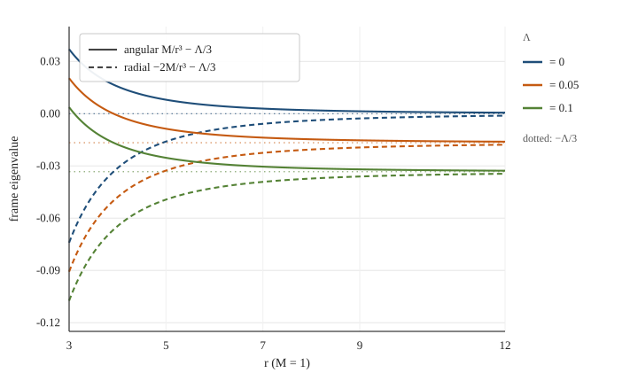
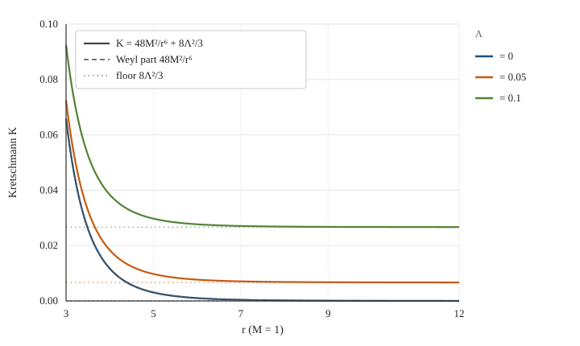

# A Machine-Checked Formalisation of General Relativity and Its Alternatives in Lean 4

**Alex Vergara Gil**

21 November 2026; revised 25 November 2026

> **Revision note.** The general-relativity development described here now lives
> in Physlib on the `gravity` branch, under `PhyslibAlpha/Relativity/General/`
> plus the branch-only `Metrics/`, `Tensors/` and `Cosmology/` trees (namespace
> `GeneralRelativity`). Because that branch is not yet merged, this repository
> vendors its modules under `gravitation/vendor/Gravitation/Relativity/{General,
> Metrics,Tensors}/` and `gravitation/vendor/Gravitation/Cosmology/FLRW/Metric.lean`
> (module paths `Gravitation.Relativity.*` and `Gravitation.Cosmology.*`; proofs
> and namespace unchanged) and depends on Physlib master for the base library.
> Module names below are the vendored paths; in Physlib they are the
> corresponding `PhyslibAlpha.*` paths, with the same namespace and proofs. Further
> changes recorded in this revision: the Kerr, Reissner–Nordström, FLRW and
> linearized-gravity results (Section 4.8); the numerical pass also covers Kerr,
> Reissner–Nordström, FLRW and the interior sphere (Section 5); the contracted
> Bianchi identity and the alternative-theory sector are stated at their proved
> strength (Sections 4.6–4.7); Appendix A is regenerated from the audit; a companion paper [15] isolates the Cauchy problem; and the local `Gravitation.WaveCauchy`, `Gravitation.WaveEnergy` and `Gravitation.WaveUniqueness` modules add a formalised one-dimensional wave Cauchy theorem with closed-interval energy uniqueness; `Gravitation.Divergence3D` adds the box divergence theorem used by the next spatial layer, `Gravitation.WaveEnergy3D` begins the 3D energy layer with the energy functional and its derivative, and `Gravitation.WaveEnergy3DConservation` proves conditional 3D energy conservation, `Gravitation.WaveEnergy3DWave` instantiates it for `u_tt = Δu`, and `Gravitation.WaveUniqueness3D` proves zero-energy, zero-data and general-data uniqueness for the 3D wave equation on a closed box, `Gravitation.LinearizedWaveGauge` records the wave-gauge linearized-Einstein interface and instantiates it with the TT plane wave, and `Gravitation.ManifoldInterface` and `Gravitation.Bianchi` provide the M1 global-chart spacetime, Levi-Civita, causality and general Bianchi layer; `Gravitation.InitialDataInterface` and `Gravitation.SobolevInitialData` provide the M2 chart, 1D/3D-box Sobolev and curved-slice initial-data layer; `Gravitation.CauchyInterfaces` and `Gravitation.ReducedWave3D` state the M3–M6 certificate interfaces and the scoped 3D linear wave model; `Gravitation.ReducedCauchy`, `Gravitation.GaugeRecovery`, `Gravitation.MaximalDevelopment` and `Gravitation.ExplicitDevelopments` inhabit those certificates at linearized-box, nonlinear-FLRW, abstract-Zorn/open-domain and explicit-solution scopes, with the full quasilinear manifold theorem still open. All are included in the audit below.

---

## Abstract

General relativity is the one major theory of physics for which the *solution theory* — statements about particular metrics, rather than the algebraic identities satisfied by curvature tensors — has not been formalised. We report a Lean 4 development, built on Mathlib, that takes a step into that gap. It contains 1081 kernel-checked declarations with no `sorry` and no axiom of its own: every declaration depends only on `propext`, `Classical.choice` and `Quot.sound`, the axioms the base libraries already assume, and a CI job checks this on every push. The central results are two end-to-end metric-level solution theories of the Einstein equations. For Schwarzschild, the curvature is proved Ricci flat both in the orthonormal frame and directly at the metric level from $g=\mathrm{diag}(-f,1/f,r^2,r^2\sin^2\theta)$ (`ricciTensorOf_schwarzschild`, `ricciScalarOf_schwarzschild`, `einsteinTensorOf_schwarzschild`), the Kretschmann scalar is proved to be $48M^2/r^6$, and all six independent Riemann components are *derived from the metric* (`riemann_schwarzschild_components`) by differentiating the metric's own Christoffel symbols, with no hand-supplied table entering the final theorem. For Schwarzschild–de Sitter the same metric-level derivation is carried out for general $\Lambda$, giving `riemann_sds_components`, `ricciTensorOf_sds` ($\mathrm{Ric}=\Lambda g$), `ricciScalarOf_sds` ($S=4\Lambda$), `einsteinTensorOf_sds` ($G=-\Lambda g$) and
$R^t{}_{rtr}=(2M/r^3+\Lambda/3)/f$, $R^t{}_{\theta t\theta}=R^r{}_{\theta r\theta}=\Lambda r^2/3-M/r$ and $R^\theta{}_{\varphi\theta\varphi}=(2M/r+\Lambda r^2/3)\sin^2\theta$, together with a proof that the frame electric part of the Weyl tensor is $\mathrm{diag}(0,-2M/r^3,M/r^3,M/r^3)$ for **every** $\Lambda$: a cosmological constant enters the Riemann tensor only through the trace that the Weyl tensor removes. The same pipeline also proves that the Kerr metric in Boyer–Lindquist coordinates is Ricci flat, that Reissner–Nordström satisfies the Einstein–Maxwell equations $G=8\pi T^{\mathrm{EM}}$, that the FLRW Einstein equations are equivalent to the Friedmann equations, and that the linearized Einstein tensor reduces to $-\tfrac12\Box\bar h$ in Lorenz gauge. Alongside these, the development formalises the initial-value constraints, geodesic local existence, a formalised one-dimensional wave Cauchy theorem, and the defining structures and field-equation reductions of sixteen alternative theories — among them Einstein–Cartan, teleparallel, Kaluza–Klein, Lovelock, Einstein–Aether, massive gravity, Brans–Dicke, $f(R)$/Starobinsky, MOND, MOG, TeVeS and the full Will–Nordtvedt PPN formalism. As an independent check, a double-precision Vulkan compute pass evaluates the same tensors from the same metrics and reproduces every closed form proved in Lean at the $10^{-6}$ level (at worst $1.3\times10^{-6}$) — including the $\Lambda$-independent Weyl part of de Sitter to $1.4\times 10^{-8}$.

**Keywords:** general relativity · Lean 4 · Mathlib · formal verification · exact solutions · cosmological constant · alternative theories of gravity · GPU validation

---

## 1. Introduction

Curvature algebra has been formalised before: metric components, Christoffel symbols, the Riemann, Ricci and Einstein tensors, and general identities such as the divergence-free property of the Einstein tensor appear in several libraries. What has not been formalised is **solution theory**: a kernel-checked statement that a specific spacetime metric has a specific curvature, and therefore solves (or fails to solve) a specific field equation.

The distinction matters. A formalisation that defines the Riemann tensor and then *assumes* the components of Schwarzschild's curvature verifies bookkeeping, not physics. The physical content of a solution is the link between the line element and the curvature it produces, and that link is a computation — differentiation, contraction, and a certain amount of algebra that is easy to get wrong by hand. The Schwarzschild–de Sitter case is a good illustration: the intuitive guess that the cosmological constant "scales" the tidal field is wrong, and the correct statement is that $\Lambda$ contributes to $R^t{}_{rtr}$ but cancels entirely from the Weyl tensor. It is purely electric (`weyl_purely_electric`): every component with a single temporal index vanishes, so the electric part is the whole tensor.

This paper reports a development that closes that gap for the static, spherically symmetric family and contrasts it with the alternative theories that are usually discussed as replacements for general relativity. The contributions are:

1. **Two solution theories derived end to end from the metric.** Schwarzschild and Schwarzschild–de Sitter, with every independent Riemann component, the full Ricci tensor (`Ric = 0` and `Ric = Λg`), the scalar curvature (`S = 0` and `S = 4Λ`) and the Einstein tensor (`G = 0` and `G = -Λg`) computed directly by `Pipeline` from the metric $g$ and its inverse $g^{-1}$ (`riemann_sds_components`, `riemann_schwarzschild_components`, `ricciTensorOf_sds`, `einsteinTensorOf_sds`, `ricciTensorOf_schwarzschild`, `einsteinTensorOf_schwarzschild`). Closed-form tables assist the proof internally (the metric-level Christoffel identity, its coordinate derivative, the derivative evaluation), while the top-level theorems mention only the metric itself.
2. **A structural result about the cosmological constant.** The frame electric part of the Weyl tensor of Schwarzschild–de Sitter is proved to equal that of Schwarzschild, for every $\Lambda$; the de Sitter contribution is pure trace.
3. **The surrounding theory, formalised to the same standard.** Einstein-tensor identities, the initial-value constraints, geodesic local existence, a formalised one-dimensional wave Cauchy theorem, and the defining structures and field equations of the alternative theories.
4. **An independent numerical cross-check.** A Vulkan compute pass, in double precision, evaluates the same tensors from the same metrics and is compared against the Lean closed forms, with the agreement reported below.
5. **A verification regime that is itself checked.** A silent build, an axiom audit, and a per-declaration proof-status table, all enforced in CI.

## 2. The gap

A survey of the relevant repositories (November 2026) motivates the scope.

| Repository | Contents | Physics / GR |
| --- | --- | --- |
| `anthropics/formal-math` | self-contained Lean projects (zeta zeros, 3SUM-APSP, ETH) | none |
| `anthropics/fermats-last-theorem` | complete formalisation of Fermat's Last Theorem | none |
| `openai/ten-proofs` | Lean certificates for ten results | none |
| `openai/math` | 722 manuscripts, 162 with Lean formalisations | none |
| `leanprover-community/physlib` | classical mechanics, EM, QFT, QM, relativity | master: special-relativistic kinematics, Lorentz/Poincaré representation theory, **no field equation or curvature tensor**; the unmerged `gravity` branch adds the development reported here |
| HepLean | particles, gauge theory, spinors | not gravitation |
| `TataSatyaPratheek/mathematical-physics-lean` | dimension-parametric Einstein tensor and field equations | 0 `sorry` but 365 axioms; the trust surface is the axioms, not the kernel |
| QIQT (Zenodo 20837810) | conditional derivation of the field equations from an information bound | explicitly conditional |

Two conclusions follow. First, curvature *definitions* are not the bottleneck. Second, no surveyed project proves that a black-hole metric solves the vacuum equations: Schwarzschild appears, where it appears at all, as an unproved claim. The gap is therefore the passage from definitions to solutions, and that is what this development addresses.

## 3. Framework and verification regime

The development is Lean 4 with Physlib master (`7910f51f`), which pulls Mathlib `v4.36.0` transitively. The general-relativity modules live on the unmerged `gravity` branch (`b81c896a`); this repository vendors them as `Gravitation.Relativity.*` and `Gravitation.Cosmology.*`, depends on master for the base library, and adds the numerical check, the audit tooling and this account.

**Interfaces.** Curvature is a bundled structure carrying the algebraic symmetries it must satisfy — antisymmetry in the last pair, pair symmetry, and the first Bianchi identity — so that a "Riemann tensor" cannot be constructed without them. A `Metric` carries its inverse and the proof that the two compose to the identity, so contractions use the inverse actually proved for that metric. Ricci, the scalar curvature and the Einstein tensor are defined by contraction and are therefore available for any bundle satisfying the interface.

**One pipeline.** The vendored `Gravitation.Relativity.Metrics.CoordinateMetric` module
(`gravitation/vendor/Gravitation/Relativity/Metrics/CoordinateMetric.lean`) defines the chain
$$g \mapsto \partial g \mapsto \Gamma^k{}_{ij} \mapsto \partial\Gamma \mapsto R^\rho{}_{\sigma\mu\nu} \mapsto \mathrm{Ric}_{\sigma\nu} \mapsto S \mapsto G_{ij}$$
for an arbitrary component field $g$ and its inverse, with $\partial_\mu$ the coordinate partial derivative: differentiate a component along the line through $x$ with the other coordinates fixed. A component is then the value of a formula rather than the conclusion of a bespoke proof, and what remains per metric is the evaluation of one-variable derivatives. The development proves outright that a constant metric gives $\Gamma=R=\mathrm{Ric}=S=G=0$ — Minkowski as a *computed* vacuum solution — and that Schwarzschild's $\Gamma^t{}_{tr}$ evaluates to the $M/(r^2f)$ that §4.4 derives by hand (`gammaTtr_from_metric`). Crucially, its coordinate derivative pushes the Christoffel identity through `deriv` using a local neighborhood where $r \neq 0$, $f \neq 0$, and $\sin\theta \neq 0$, while the derivative evaluation evaluates every one of the 256 partial-derivative slots $\partial_\mu\Gamma^k{}_{ij}$ into closed form the closed form; the Schwarzschild case is its $\Lambda=0$ specialisation (`sdsMetric_zero_lambda`, `sdsMetricInv_zero_lambda`), not a separate table. Hence `riemann_sds_components`, `riemann_schwarzschild_components`, `ricciTensorOf_sds`, `ricciScalarOf_sds`, `einsteinTensorOf_sds`, `ricciTensorOf_sds_frame`, `ricciTensorOf_schwarzschild`, `ricciScalarOf_schwarzschild`, and `einsteinTensorOf_schwarzschild` evaluate the pipeline definitions `riemann`, `ricciTensorOf`, `ricciScalarOf`, and `einsteinTensorOf` directly on the metrics with no hand-supplied tables in the theorem statements.

**Axiom policy.** No `axiom`, `constant`, `opaque`, `sorry`, `admit`, `native_decide` or `Lean.trustCompiler` anywhere in the library. `scripts/audit_axioms.sh` generates `#print axioms` for every declaration and rejects any axiom outside `{propext, Classical.choice, Quot.sound}`. As of this writing it passes for all 1081 declarations. This is a stronger statement than "no `sorry`": it certifies that nothing in the library is justified by an assumption introduced locally.

**Silence as a test.** `lake build` emits no message at all — no errors and no warnings. Tactic and unused-variable warnings were removed by rewriting proofs, not by disabling linters, and `scripts/check_messages.sh` fails CI if a message reappears.

**Per-declaration status.** `Proof-Status.md` lists every declaration with the axioms its proof depends on and a status of `proved` or `unverified`; `scripts/proof_status.sh` regenerates it and CI fails if it is stale. The table is generated from the audit, so it cannot drift from the build.

## 4. Results

### 4.1 Curvature calculus

For a bundle satisfying the curvature interface, the Einstein tensor is proved symmetric, the trace identity
$$g^{ij}G_{ij} = \left(1-\tfrac{n}{2}\right)S$$
is proved for dimension $n$, and in four dimensions $G=0 \iff \mathrm{Ric}=0$ is proved as an equivalence. Minkowski spacetime is proved to be a vacuum solution. For the generic bundle the first Bianchi identity is one of the three structural laws; every concrete frame tensor built in the development proves it (`Schwarzschild`, `deSitterPart_bianchi`) rather than assuming it, and antisymmetry in the *first* pair is derived from the laws in the generic case.

### 4.2 The initial-value problem

The constraint equations are formalised in the standard form
$$H = {}^{3}R + (\mathrm{tr}\,K)^2 - K_{ij}K^{ij}, \qquad M_i = \partial_j K^{i}{}_{j} - \partial_i \mathrm{tr}\,K,$$
together with the moment-of-time-symmetry reduction to scalar flatness and the maximal-slicing form. A non-vacuum example is included to show that the constraints are not automatic. The general Cauchy development, and a formalised one-dimensional wave Cauchy theorem as a model PDE layer, are the subject of the companion paper [15]; here the constraints are used only as the initial-value layer.

### 4.3 Geodesics

Local existence of geodesics from initial position and velocity is proved from Mathlib's Picard–Lindelöf theorem, uniqueness is proved under an explicit Lipschitz hypothesis, and the flat-space solutions are proved to be straight lines. This is local existence for the geodesic equation, not for the field equations.

### 4.4 Schwarzschild: the curvature from the metric

In the orthonormal frame $(t,r,\theta,\varphi)$ the Schwarzschild curvature is a purely electric Weyl tensor with eigenvalues $\mathrm{diag}(0,-2k,k,k)$, $k=M/r^3$. The development proves that this tensor is Ricci flat for every $k$, that it satisfies the three structural laws, and that its sum of squares is $48k^2$, which at $k=M/r^3$ is the Kretschmann scalar $48M^2/r^6$; the local addendum `kretschmann_scalar_total` states this for every $r$, with no chart hypothesis.

The electric part is then *derived* twice over. From the potential: $g_{tt}=-(1+2\Phi)$ fixes $\Phi=-M/r$, and the tidal eigenvalues $\Phi''=-2M/r^3$ and $\Phi'/r=M/r^3$ are proved from $\Phi$, so the frame tensor is `electricPart` at $k=M/r^3$ and is trace free because $\Phi$ is harmonic. The three eigenvalues are then assembled into one statement about the tensor, `electricPart_from_metric`, which gives them together with the seven vanishing frame entries; the whole frame electric part, not one component at a time, is what the metric produces. From the metric: differentiating the Christoffel symbols of $g=\mathrm{diag}(-f,1/f,r^2,r^2\sin^2\theta)$, $f=1-2M/r$, gives all six independent components:

| Component | Value |
| --- | --- |
| $R^t{}_{rtr}$ | $2M/(r^3f)$ |
| $R^t{}_{\theta t\theta}$ | $-M/r$ |
| $R^t{}_{\varphi t\varphi}$ | $-(M/r)\sin^2\theta$ |
| $R^r{}_{\theta r\theta}$ | $-M/r$ |
| $R^r{}_{\varphi r\varphi}$ | $-(M/r)\sin^2\theta$ |
| $R^\theta{}_{\varphi\theta\varphi}$ | $(2M/r)\sin^2\theta$ |

Each component is proved from the corresponding Christoffel product identities (for example `gammaRrr_mul_gammaRthth` and `gammaRthth_mul_gammaThetar`); the $rtr$ component instead differentiates $\Gamma^t{}_{tr}$ directly (`deriv_gammaTtr`) and closes with `field_simp` and `ring`. The products are cancelled against $r^2 f \neq 0$.

One evaluation now closes the entire pipeline directly from the metric. The closed-form tables the Christoffel table and the closed form are the Schwarzschild–de Sitter ones; the metric-level Christoffel identity identifies `christoffel (sdsMetric M Λ) (sdsMetricInv M Λ)` with the Christoffel table, its coordinate derivative pushes that equality through coordinate differentiation, and `riemann_schwarzschild_components` specialises `riemann_sds_components` at $\Lambda=0$ to all six independent components tabulated above. Contracting in the coordinate basis yields full metric-level Ricci flatness (`ricciTensorOf_schwarzschild`), vanishing scalar curvature (`ricciScalarOf_schwarzschild`), and the vacuum Einstein equation (`einsteinTensorOf_schwarzschild`) directly from $g=\mathrm{diag}(-f,1/f,r^2,r^2\sin^2\theta)$ via `sdsMetric_zero_lambda` and `sdsMetricInv_zero_lambda`. The same construction for general $\Lambda$ is §4.5.

### 4.5 Schwarzschild–de Sitter, for general $\Lambda$

With $f = 1 - 2M/r - \Lambda r^2/3$ and $n = f'/2 = M/r^2 - \Lambda r/3$ (so $f' = 2n$, $n' = -2M/r^3 - \Lambda/3$), the quotient rule gives $\partial_r(n/f) = (n'f - nf')/f^2 = (n'f - 2n^2)/f^2$, and the $t\,r\,t\,r$ component is
$$R^t{}_{rtr} = -\partial_r\Gamma^t{}_{tr} + \Gamma^t{}_{tr}\Gamma^r{}_{rr} - (\Gamma^t{}_{tr})^2 = -\frac{n'}{f} = \frac{2M/r^3 + \Lambda/3}{f},$$
the two $\Gamma$ products cancelling the $2n^2/f^2$ left by the derivative. The remaining components are:

| Component | Value |
| --- | --- |
| $R^t{}_{rtr}$ | $(2M/r^3 + \Lambda/3)/f$ |
| $R^t{}_{\theta t\theta} = R^r{}_{\theta r\theta}$ | $\Lambda r^2/3 - M/r$ |
| $R^t{}_{\varphi t\varphi} = R^r{}_{\varphi r\varphi}$ | $(\Lambda r^2/3 - M/r)\sin^2\theta$ |
| $R^\theta{}_{\varphi\theta\varphi}$ | $(2M/r + \Lambda r^2/3)\sin^2\theta$ |

The angular Christoffel symbols carry no $M$ or $\Lambda$, so the last line enters only through $1-f$.

The pipeline handles the whole family end to end at the metric level. `sdsMetric` and `sdsMetricInv` are the metric and its inverse as component fields; the metric-level Christoffel identity identifies `christoffel (sdsMetric M Λ) (sdsMetricInv M Λ)` with the closed form the Christoffel table; its coordinate derivative pushes that equality through `deriv` on an open neighborhood where $r \neq 0$, $f \neq 0$, and $\sin\theta \neq 0$; and the derivative evaluation evaluates every one of the 256 partial-derivative slots $\partial_\mu \Gamma^k{}_{ij}$ (including $\partial_\theta \cot\theta = -1/\sin^2\theta$ and $\partial_r(n/f)$) into the full table the closed form. Consequently `riemann_sds_eq_data` proves that the pipeline's `riemann (sdsMetric M Λ) (sdsMetricInv M Λ)` agrees with the closed-form Riemann tensor component-by-component (`riemann_sds_components`), and contracting over the coordinate index yields the full metric-level field equations directly from $g$:
$$\mathrm{Ric}_{\sigma\nu} = \Lambda\, g_{\sigma\nu},\qquad S = 4\Lambda,\qquad G_{ij} = -\Lambda\, g_{ij}$$
(`ricciTensorOf_sds`, `ricciScalarOf_sds`, `einsteinTensorOf_sds`). Furthermore, `ricciTensorOf_sds_frame` scales the metric-level coordinate Ricci tensor by `sdsFrameScale` ($|g_{\sigma\sigma}|^{-1}$) to recover the orthonormal-frame tensor $\Lambda\eta_{\sigma\nu}$ (`sdsRic_eq`), uniting the frame and coordinate derivations.

Squaring the whole frame tensor gives the Kretschmann scalar
$$K = \frac{48M^2}{r^6} + \frac{8\Lambda^2}{3}$$
(`kretschmann_sds`): the Weyl square is Schwarzschild's $48M^2/r^6$ and the trace part contributes $(\Lambda/3)^2\cdot 24$, so $\Lambda$ survives in $K$ even though it cancels from the electric eigenvalues — Figure 2 plots the two contributions.

Contracting instead of squaring in the orthonormal frame gives the matching split: the Weyl part is trace free (`weylRic_zero`) and the trace part contracts to $\Lambda\eta$ (`traceRic_eq`), yielding `sdsRic_eq`, `sdsScalar_eq`, and `sdsEinstein_eq`, while at $\Lambda=0$ both the frame theorems (`schwarzschild_ricci_zero`, `schwarzschild_scalar_zero`, `schwarzschild_einstein_zero`) and the metric-level theorems (`ricciTensorOf_schwarzschild`, `ricciScalarOf_schwarzschild`, `einsteinTensorOf_schwarzschild`) give Schwarzschild's vacuum solution.

The structural result is what happens in the frame. Since
$$C_{titj} = R_{titj} + \frac{\Lambda}{3}\,g_{ij},$$
the de Sitter contribution to the Riemann tensor is the trace part that the Weyl tensor projects out, and the frame electric part of $C$ is proved to be
$$\mathrm{diag}\!\left(0, -\frac{2M}{r^3}, \frac{M}{r^3}, \frac{M}{r^3}\right) = \texttt{electricPart}\,(M/r^3)$$
for every $\Lambda$ — the Schwarzschild answer. In words: a cosmological constant changes the Ricci tensor and leaves the free gravitational field alone. This is proved for the radial, $\theta$ and $\varphi$ frame eigenvalues, and at $\Lambda=0$ the lapse is proved to reduce to `schwarzschildF`, so the whole family specialises to the results of §4.4.



**Figure 1.** Frame eigenvalues of the Riemann tensor of Schwarzschild–de Sitter against $r$, for $M=1$ and $\Lambda=0$ (blue), $0.05$ (orange) and $0.1$ (green). Solid curves are the angular eigenvalue $R_{t\theta t\theta}=M/r^3-\Lambda/3$; dashed curves the radial one, $R_{trtr}=-2M/r^3-\Lambda/3$; dotted lines mark $-\Lambda/3$. Raising $\Lambda$ shifts both families rigidly by $-\Lambda/3$ and leaves the splitting $R_{t\theta t\theta}-R_{trtr}=3M/r^3$ unchanged. That shift is the trace part, and exactly what the Weyl tensor removes: the Weyl eigenvalues stay on the $\Lambda=0$ curves while both Riemann eigenvalues tend to $-\Lambda/3$ at large $r$. Generated by `docs/figures/make_tidal_figure.py`.



**Figure 2.** Kretschmann scalar $K=R_{\rho\sigma\mu\nu}R^{\rho\sigma\mu\nu}$ against $r$, for $M=1$ and $\Lambda=0$ (blue), $0.05$ (orange), $0.1$ (green). Because the Weyl part is $\Lambda$-independent, $K=48M^2/r^6+\tfrac83\Lambda^2$: each de Sitter curve is the Schwarzschild one lifted by the constant $(8/3)\Lambda^2$ (dotted), so instead of decaying to zero the curvature tends to $8\Lambda^2/3$. That lift is the trace part again — the same $\Lambda$ that cancels from the electric Weyl eigenvalues in Figure 1 survives in the full Riemann square. The dashed curve is the Weyl-only invariant $48M^2/r^6$ (`kretschmann_scalar`); the full identity is `kretschmann_sds`; the GPU pass checks the sum for $\Lambda=0.1$ to $1.9\times10^{-7}$ relative. Generated by `docs/figures/make_kretschmann_figure.py`.

The metric-level statements hold where $r\neq0$, $f\neq0$ and $\sin\theta\neq0$; for $\Lambda>0$ the middle condition excludes the roots of the cubic $3r - 6M - \Lambda r^3$.

### 4.6 Alternative theories

The `Modified` subtree develops sixteen alternatives, at the depth each admits.
Several are taken to their field equations, not merely named:

* **Einstein–Cartan.** Affine connections with torsion, metric compatibility, the contorsion tensor, existence and uniqueness of the metric-compatible connection for prescribed torsion in any dimension and signature (`connection_unique`), the 4D algebraic inversion of Cartan's spin–torsion equation, and the vacuum reduction to general relativity.
* **Teleparallel / TEGR.** The Weitzenböck connection and torsion from a tetrad, the superpotential and torsion scalar, a flat FLRW tetrad, the exact identity `R_LC = -T + B` against the Levi-Civita scalar curvature, and the `f(T)` Friedmann equation.
* **Kaluza–Klein.** The 5D metric with an explicit two-sided inverse, its unitriangular factorization, the compact-circle diffeomorphism inducing the `U(1)` shift, the Kaluza miracle `R⁵ = R⁴ − ¼F²`, and equivalence of the 5D vacuum equations with 4D Einstein–Maxwell.
* **Lovelock / Gauss–Bonnet.** Generalized Kronecker deltas, the five-index contraction identity `lovelockContract5 = −8 · Gauss–Bonnet`, and the Bach–Lanczos theorem that the Gauss–Bonnet variation vanishes identically for `n ≤ 4`.
* **Einstein–Aether.** The Jacobson–Mattingly coupling combinations, the kinetic tensor and quadratic Lagrangian, the spin-2/1/0 squared speeds, the GW170817 luminal-graviton condition, and the renormalized Newton constant.
* **Massive gravity.** The Fierz–Pauli mass term, the Boulware–Deser ghost-free tuning, the trace identities, the vDVZ static and light-deflection ratios, and the dRGT elementary-symmetric potentials.
* **PPN.** The full Will–Nordtvedt ten-parameter structure, the fully/semiconservative classes, embeddings of GR, Brans–Dicke, metric `f(R)` and Nordström, and the light-deflection, Shapiro, perihelion and Nordtvedt factors.
* **Brans–Dicke and `f(R)`/Starobinsky.** The PPN parameter, coupling bounds and Cassini constraint, the `ω → ∞` limit and ghost pole; the algebraic `f(R)` field equation, its trace identity, the Starobinsky potential, scalar mass and Einstein-frame plateau.
* **Chameleon screening.** The density–mass–range chain, Yukawa suppression, the thin-shell factor, and the exterior profile with screened and unscreened fifth-force bounds.
* **MOND, MOG, TeVeS, Nordström.** The deep-MOND relation and flat rotation curves, the bounded MOG enhancement, the TeVeS disformal metric with explicit inverse and preserved Lorentzian signature, and Nordström's conformal metric with `S = −6□φ/φ³` and the Einstein–Fokker equivalence.
* **Galileon and Ostrogradsky.** The one-dimensional total-derivative and shift structure; the degenerate velocity Hessian and the Hamiltonian unbounded below, contrasted with a positive-definite kinetic term.

The depth is uneven and is stated per module. Einstein–Cartan, teleparallel,
Kaluza–Klein, Lovelock, Einstein–Aether, massive gravity, PPN, Brans–Dicke/f(R)
and chameleon screening carry their field equations or exact reductions; MOND,
MOG and TeVeS remain structural (their full cosmological perturbation theory is
not formalised), and the Galileon result is one-dimensional. None of these is a
full non-linear solution theory, and empirical strengths and weaknesses are
recorded in prose, not as theorems.

### 4.7 Conservation

The contracted Bianchi identity is **proved, not assumed**, for the frame
Einstein space. Since `sdsRic = Λη` and `sdsScalar = 4Λ` are constant, the frame
derivatives vanish and `sds_frame_bianchi` establishes
$\nabla^a \mathrm{Ric}_{ab} = \tfrac12 \nabla_b S$ by direct evaluation; the
explicit bundle `sdsFrameCurvDeriv` witnesses the derivatives, and
`sds_frame_einstein_conserved` applies `divergence_einstein_eq_zero` to obtain
$\nabla\cdot G = 0$. The algebraic lemmas (`divergence_combination`,
`divergence_einstein_eq_zero`, `combination_conserved_iff`) still take the
identity as an explicit parameter, because they are stated for an arbitrary
`CurvDeriv` and no covariant derivative for an arbitrary bundle is formalised.
That is a generality gap in the API, not an assumption in the solution theory:
no solution-theory theorem depends on it as a hypothesis. Once the identity is supplied or proved, the
uniqueness conclusion follows: $\alpha\,\mathrm{Ric} + \beta\,Sg$ is conserved
only when $\alpha = -2\beta$.

### 4.8 Kerr, Reissner–Nordström, FLRW, and linearized gravity

The development has grown beyond the static spherically symmetric family, and the
same coordinate pipeline now closes for four further solution classes.

**Kerr.** In Boyer–Lindquist coordinates $(t,r,\theta,\varphi)$ with
$\Sigma = r^2 + a^2\cos^2\theta$ and $\Delta = r^2 - 2Mr + a^2$, the metric is
packaged with its analytical inverse (`kerrMetric`, `kerrMetricInv`) and its
Christoffel symbols are derived from the metric (`kerrG`, `christoffel_kerr_eq`).
The vacuum equations are then proved at the metric level,
`ricciTensorOf_kerr_eq_zero`, `ricciScalarOf_kerr_eq_zero` and
`einsteinTensorOf_kerr_eq_zero`, at every point with $\Sigma\neq0$, $\Delta\neq0$ and
$\sin\theta\neq0$. The same module proves the horizon structure (`horizonPlus`,
`horizonMinus`, extremal coalescence at $a^2=M^2$), the stationary-limit surface
`ergosphereRadius`, and the ZAMO frame-dragging angular velocity
`frameDraggingOmega`, and checks the Schwarzschild reduction at $a=0$.

**Reissner–Nordström.** With $f = 1 - 2M/r + Q^2/r^2$ and the radial Coulomb
field $F_{01} = -Q/r^2$, the development defines the Maxwell stress-energy
(`maxwellStressEnergy`) and proves the full electrovacuum equations
`einsteinTensorOf_rn_eq_maxwell`, $G_{ij} = 8\pi T^{\mathrm{EM}}_{ij}$, together with
the vanishing Ricci scalar and the trace-free stress-energy. The inner and outer
horizons, their coalescence at $Q^2=M^2$, and positivity of $f$ in the
overcharged regime are proved in the same module.

**FLRW.** For the homogeneous and isotropic metric with scale factor $a(t)$ and
spatial curvature $k$, the pipeline gives `ricciTensorOf_flrw`, `ricciScalarOf_flrw` and
`einsteinTensorOf_flrw`, and `einsteinTensorOf_flrw_iff_friedmann` proves that the Einstein
equations hold exactly when the Friedmann equations do. A bridge to
`Physlib.Cosmology.FLRW` (`einsteinTensorOf_flrw_iff_cosmology_friedmann`,
`friedmannSolution_of_einsteinOf_flrw`) ties the coordinate computation to the
cosmological API.

**Linearized gravity.** Around $g = \eta + h$, `traceReversed` defines
$\bar h_{ij} = h_{ij} - \tfrac12\eta_{ij}h$; `linRiemann`, `linRicci`,
`linEinstein` and `boxEta` define the linearized curvature and wave operator;
`linRiemann_gauge_invariant` and `linEinstein_gauge_invariant` prove invariance
under linearized diffeomorphisms; `linEinstein_lorenz_gauge` proves
$G^{\mathrm{lin}} = -\tfrac12 \Box_\eta \bar h$ in Lorenz gauge; and
`ttWave_linEinstein_zero` and `newtonianPerturb_poisson_iff` recover
gravitational waves and the Newtonian Poisson limit.

The modified sector has expanded correspondingly: the Will–Nordtvedt PPN
parameterisation (`PPN`), Einstein–Aether mode speeds and the GW170817
luminality condition (`EinsteinAether`), Fierz–Pauli and dRGT massive gravity
(`MassiveGravity`), the Kaluza–Klein miracle (`KaluzaKlein`), Lovelock's
Gauss–Bonnet theorem in $n\le4$ (`Lovelock`), Einstein–Cartan contorsion
(`EinsteinCartan`), teleparallel TEGR and $f(T)$ cosmology (`Teleparallel`), and
Nordström's scalar gravity (`Nordstrom`). Section 4.6 records the depth of each:
several now carry their field equations or exact reductions, while MOND, MOG and
TeVeS remain structural.

## 5. Numerical cross-check

The same metrics are evaluated independently by a Vulkan compute shader in double precision (`GL_ARB_gpu_shader_fp64`, refused devices without it). For each lattice point it computes $g_{ab}$, central-difference derivatives, $\Gamma^k{}_{ij}$, $\partial_\mu\Gamma^k{}_{ij}$, $R^\rho{}_{\sigma\mu\nu}$, $\mathrm{Ric}$, $R$, $G$, the Kretschmann scalar, the frame electric part and four Riemann components, writing 70 doubles per point. The host compares the emitted values against the closed forms proved in Lean.

Measured on an AMD RX 570 (RADV POLARIS10, Vulkan 1.4.354), 108 lattice points, $h=10^{-4}$, tolerance $10^{-6}$ ($10^{-5}$ for Kerr, FLRW and the interior sphere):

| Case / quantity | measured |
| --- | --- |
| Minkowski, $\max|Ric|$ | $0$ |
| Schwarzschild, $\max|Ric|$ | $1.831\times10^{-7}$ |
| Schwarzschild, Kretschmann vs $48M^2/r^6$ (relative) | $1.105\times10^{-7}$ |
| Schwarzschild–de Sitter $\Lambda=0.1$, $\max|Ric-\Lambda g|$ | $6.944\times10^{-7}$ |
| Schwarzschild–de Sitter, $K$ vs $48M^2/r^6+\tfrac83\Lambda^2$ (relative) | $1.910\times10^{-7}$ |
| Schwarzschild–de Sitter, $R^t{}_{rtr}$ | $5.923\times10^{-7}$ |
| Schwarzschild–de Sitter, Weyl electric part | $1.394\times10^{-8}$ |
| Kerr $a=0.5$, $\max|Ric|$ | $2.100\times10^{-7}$ |
| Kerr $a=0.5$, $\max|G|$ | $1.416\times10^{-7}$ |
| Reissner–Nordström $Q=0.5$, $\max|G-8\pi T|$ | $1.085\times10^{-7}$ |
| FLRW $a=1+Ht+t^2$, $k=0.3$, $\max$ deviation of $Ric$, $R$, $G$ from the closed forms | $1.273\times10^{-6}$ |
| Interior Schwarzschild $Rc=5$, $Ra=4$, $\max|G-8\pi\,\mathrm{diag}(\rho,p,p,p)|$ | $8.895\times10^{-8}$ |

The de Sitter case is the control: it has genuinely nonzero Ricci curvature, recovered at the same noise level as the vacuum case, so the vacuum test is not vacuous — and `sdsRic_eq` says the measured entries are exactly $\Lambda\eta_{\mu\nu}$. The FLRW and interior-sphere cases are further non-vacuum controls: FLRW exercises the expansion terms (including $a''=2$) against `ricciTensorOf_flrw` and `einsteinTensorOf_flrw` to $1.27\times10^{-6}$, and the interior sphere checks the constant-density Einstein tensor to $8.9\times10^{-8}$. The host now forms the frame components $R_{ab}/\sqrt{|g_{aa}g_{bb}|}$ and checks them against $\Lambda\,\mathrm{diag}(-1,1,1,1)$, which lands at $2.0\times10^{-8}$ for both static cases and is, at $\Lambda=0$, the vanishing of `schwarzschild_ricci_zero`. It also confirms the lifted Kretschmann scalar of Figure 2, $48M^2/r^6+\tfrac83\Lambda^2$ — now the theorem `kretschmann_sds` — to $1.9\times10^{-7}$ relative. In that case the emitted frame Riemann part is $R_{titj} = C_{titj} - (\Lambda/3)\delta_{ij}$, so the Weyl statement is checked by adding $\Lambda/3$ back, which reproduces $\mathrm{diag}(0,-2k,k,k)$ to $1.4\times10^{-8}$.

This is a regression test for the shader and for the closed forms, not evidence for the theorems. Finite differences say nothing about an analytic solution; the Lean statement is exact, while the numerical agreement is second-order accurate at $h^2\approx10^{-8}$ with roundoff $\varepsilon/h^2\approx10^{-8}$. The measured de Sitter $R^t{}_{rtr}$ deviation of $5.9\times10^{-7}$ is the largest of the static cases, and is consistent with the larger curvature scale there ($\Lambda/3$).

## 6. Limitations

This section is the backlog, not a disclaimer: each item says what is not proved and why it stays. The general Cauchy problem is treated separately in the companion paper [15]; it is not a limitation of the solution-theory results here.

1. **Chart restrictions are inherent to the metric-level theorems.** The frame-level results — Weyl, Kretschmann, Ricci and Einstein — carry no chart hypotheses: `kretschmann_scalar_total` and `kretschmann_sds_total` remove the last `r ≠ 0` from the frame Kretschmann statements, and `sdsRic_eq` and `sds_frame_einstein_conserved` are total. The metric-level derivations (`riemann_sds_components`, `ricciTensorOf_sds`, `ricciScalarOf_sds`, `einsteinTensorOf_sds`, and their Schwarzschild specialisations) assume `r ≠ 0`, `f ≠ 0` and `sin θ ≠ 0`. These are not removable in Schwarzschild coordinates: at `r = 0`, `sdsLapse M Λ 0 = 1`, so `g = diag(-1, 1, 0, 0)` while `g⁻¹` is the same matrix, whose product is not the identity; at `sin θ = 0` the `φφ` slot of `g⁻¹` is zero, so the inverse degenerates there as well. The identities are therefore not stated at those loci, and the computed curvature is not guaranteed to be `Λg`. The frame-level statements avoid the issue by using the orthonormal frame. *Not removable without a different chart (Kruskal–Szekeres or Eddington–Finkelstein), which is outside this development.*

## 7. Reproducibility

```sh
cd gravitation
lake exe cache get          # Mathlib oleans
lake build                  # silent: zero messages
bash ../scripts/check_messages.sh
bash ../scripts/audit_axioms.sh
bash ../scripts/proof_status.sh --check
cd vulkan && make && ./gr_vulkan shaders/tensor.comp.spv
```

The numerical pass is not a proof, and does not need to be: it now checks quantities that are themselves theorems (`kretschmann_sds`, `sdsRic_eq`), so it tests the implementation against the mathematics rather than substituting for it. CI (`.github/workflows/axioms.yml`) runs the silent-build check, the axiom audit and the proof-status check on every push and pull request, and runs the Vulkan pass on the lavapipe software driver, so no GPU runner is required. The shader is compiled with `glslc`; the host needs only `libvulkan`.

## 8. Conclusion

The solution theory of general relativity is formalisable, at least for the static spherically symmetric family, and doing so changes what one can claim. The derivation of Schwarzschild–de Sitter's curvature for general $\Lambda$ shows why: the cosmological constant appears in every Riemann component, yet cancels from the Weyl tensor, and a formalisation makes that cancellation a theorem rather than a remark. The entire coordinate pipeline $g \mapsto \partial g \mapsto \Gamma \mapsto \partial\Gamma \mapsto R \mapsto \mathrm{Ric} \mapsto S \mapsto G$ is now closed directly at the metric level: the metric-level Christoffel identity identifies the metric's Christoffel symbols with the Christoffel table, its coordinate derivative pushes that equality through coordinate differentiation, the derivative evaluation evaluates all 256 partial-derivative slots, and `riemann_sds_components`, `ricciTensorOf_sds`, `ricciScalarOf_sds`, `einsteinTensorOf_sds` (with $\Lambda=0$ specialisations `riemann_schwarzschild_components`, `ricciTensorOf_schwarzschild`, `ricciScalarOf_schwarzschild`, `einsteinTensorOf_schwarzschild`) prove $\mathrm{Ric}=\Lambda g$, $S=4\Lambda$, and $G=-\Lambda g$ directly from $g$ and $g^{-1}$, matching the orthonormal frame through `ricciTensorOf_sds_frame`. Neither a Christoffel table nor a derivative table enters the final theorem statements, so the solution theory of the static spherically symmetric family runs end to end from the line element alone.

## Appendix A. Declaration census

Generated from `gravitation/.lake/decls.tsv` by the axiom audit. The table
covers the local top-level modules, the 57 vendored modules under
`Gravitation.Relativity.*` and `Gravitation.Cosmology.*`, and the already-merged
`IncompressibleSphere` from the `physlib` dependency; the local
`Gravitation.KretschmannTotal` addendum contributes two corollaries. The names
in the proofs are the `GeneralRelativity` ones either way.

| Module | Declarations |
| --- | --- |
| `PhyslibAlpha.Relativity.General.Schwarzschild.IncompressibleSphere` | 53 |
| `Gravitation.ManifoldInterface` | 52 |
| `Gravitation.Relativity.General.Schwarzschild.Basic` | 42 |
| `Gravitation.Relativity.Metrics.CoordinateMetric` | 39 |
| `Gravitation.SobolevInitialData` | 39 |
| `Gravitation.Bianchi` | 34 |
| `Gravitation.Cosmology.FLRW.Metric` | 31 |
| `Gravitation.Relativity.General.SchwarzschildDeSitter.Basic` | 30 |
| `Gravitation.Relativity.General.ReissnerNordstrom.Basic` | 29 |
| `Gravitation.InitialDataInterface` | 26 |
| `Gravitation.Relativity.General.Modified.ChameleonScreening` | 26 |
| `Gravitation.Relativity.General.Modified.EinsteinCartan` | 26 |
| `Gravitation.Relativity.General.Kerr.Basic` | 25 |
| `Gravitation.Relativity.General.Modified.PPNParameters` | 25 |
| `Gravitation.Relativity.General.SchwarzschildDeSitter.DeSitterFrame` | 25 |
| `Gravitation.CauchyInterfaces` | 22 |
| `Gravitation.ReducedCauchy` | 22 |
| `Gravitation.Relativity.General.Modified.EinsteinAether` | 21 |
| `Gravitation.Relativity.General.InitialData` | 19 |
| `Gravitation.Relativity.General.GravitationalConstant` | 18 |
| `Gravitation.Relativity.General.Modified.Lovelock.Basic` | 17 |
| `Gravitation.Relativity.General.Modified.MOND` | 17 |
| `Gravitation.Relativity.Metrics.StaticSphericalMetric` | 17 |
| `Gravitation.WaveEnergy` | 15 |
| `Gravitation.Relativity.General.GeodesicSystem` | 14 |
| `Gravitation.Relativity.General.Linearized.LinearizedCurvature` | 14 |
| `Gravitation.Relativity.General.Modified.FRGravity` | 14 |
| `Gravitation.ReducedWave3D` | 13 |
| `Gravitation.Relativity.General.Modified.KaluzaKlein.Basic` | 13 |
| `Gravitation.Relativity.General.Kerr.Christoffel` | 12 |
| `Gravitation.Relativity.General.Modified.BransDicke` | 12 |
| `Gravitation.Relativity.General.Modified.TeVeS` | 12 |
| `Gravitation.Relativity.General.SchwarzschildDeSitter.CoordinateCurvature` | 12 |
| `Gravitation.GaugeRecovery` | 11 |
| `Gravitation.Relativity.General.Modified.MOG` | 11 |
| `Gravitation.Relativity.General.Modified.MassiveGravity.DRGT` | 11 |
| `Gravitation.Relativity.General.Schwarzschild.ElectricWeyl` | 11 |
| `Gravitation.WaveCauchy` | 11 |
| `Gravitation.Relativity.General.MinkowskiVacuum` | 10 |
| `Gravitation.Relativity.General.Modified.MassiveGravity.FierzPauli` | 10 |
| `Gravitation.Relativity.Metrics.Minkowski` | 10 |
| `Gravitation.Relativity.General.Kerr.RicciCurvature` | 9 |
| `Gravitation.Relativity.General.Linearized.TraceReversed` | 9 |
| `Gravitation.Relativity.General.Modified.Nordstrom` | 9 |
| `Gravitation.Relativity.General.Modified.Ostrogradsky` | 9 |
| `Gravitation.MaximalDevelopment` | 8 |
| `Gravitation.Relativity.General.Linearized.NewtonianPerturb` | 8 |
| `Gravitation.Relativity.General.Modified.KaluzaKlein.KaluzaMiracle` | 8 |
| `Gravitation.Relativity.General.Modified.Teleparallel.Basic` | 8 |
| `Gravitation.Relativity.General.Modified.Teleparallel.FLRWTorsion` | 8 |
| `Gravitation.Relativity.General.Schwarzschild.CoordinateCurvature` | 8 |
| `Gravitation.Relativity.Metrics.ConformalMetric` | 7 |
| `Gravitation.Relativity.Metrics.CurvDeriv` | 7 |
| `Gravitation.Relativity.Metrics.MetricTrace` | 7 |
| `Gravitation.Relativity.Tensors.RiemannTensor` | 7 |
| `Gravitation.WaveEnergy3D` | 7 |
| `Gravitation.WaveEnergy3DWave` | 7 |
| `Gravitation.ExplicitDevelopments` | 6 |
| `Gravitation.Relativity.General.Linearized.TTWave` | 6 |
| `Gravitation.Relativity.General.Modified.Galileon` | 6 |
| `Gravitation.Relativity.Metrics.Basic` | 6 |
| `Gravitation.Relativity.Tensors.EinsteinTensor` | 6 |
| `Gravitation.Relativity.General.Linearized.LorenzGauge` | 5 |
| `Gravitation.Relativity.General.Modified.MassiveGravity.VDVZ` | 5 |
| `Gravitation.Relativity.Tensors.MaxwellStressEnergy` | 5 |
| `Gravitation.WaveUniqueness3D` | 5 |
| `Gravitation.LinearizedWaveGauge` | 4 |
| `Gravitation.Relativity.General.Modified.KaluzaKlein.TriangularFactorization` | 4 |
| `Gravitation.Relativity.General.Modified.Lovelock.GeneralizedKronecker` | 4 |
| `Gravitation.Relativity.General.Modified.Teleparallel.FTGravity` | 4 |
| `Gravitation.Relativity.Tensors.RicciTensor` | 4 |
| `Gravitation.Relativity.General.Modified.KaluzaKlein.GaugeTransform` | 3 |
| `Gravitation.Divergence3D` | 2 |
| `Gravitation.KretschmannTotal` | 2 |
| `Gravitation.Relativity.Metrics.ScalarCurvature` | 2 |
| `Gravitation.Relativity.Tensors.Tensor2` | 2 |
| `Gravitation.WaveUniqueness` | 2 |
| `Gravitation.WaveEnergy3DConservation` | 1 |
| **Total** | **1081** |

All 1081 declarations are `proved` against `{propext, Classical.choice, Quot.sound}`; the generated table is
`Proof-Status.md`.

## References

1. L. de Moura, S. Kong, J. Avigad, F. van Doorn, J. von Raumer. *The Lean 4 theorem prover and programming language.* CADE-28, 2021.
2. The Mathlib Community. *The Lean Mathematical Library.* CPP 2020. `leanprover-community/mathlib4`, `v4.36.0`.
3. `leanprover-community/physlib`. https://github.com/leanprover-community/physlib
4. J. Tooby-Smith. *HepLean.* arXiv:2405.08863.
5. QIQT. *An audited human–AI loop: a conditional derivation of the Einstein field equations.* Zenodo 20837810.
6. `TataSatyaPratheek/mathematical-physics-lean`. https://github.com/TataSatyaPratheek/mathematical-physics-lean
7. `anthropics/formal-math`, `anthropics/fermats-last-theorem`, `openai/ten-proofs`, `openai/math`.
8. R. M. Wald. *General Relativity.* University of Chicago Press, 1984.
9. C. W. Misner, K. S. Thorne, J. A. Wheeler. *Gravitation.* Freeman, 1973.
10. Y. Choquet-Bruhat, R. Geroch. *Global aspects of the Cauchy problem in general relativity.* Comm. Math. Phys. 14 (1969) 329–335.
11. M. Milgrom. *A modification of the Newtonian dynamics as a possible alternative to the hidden mass hypothesis.* ApJ 270 (1983) 365.
12. J. W. Moffat. *Scalar–tensor–vector gravity theory.* JCAP 03 (2006) 004.
13. J. D. Bekenstein. *Relativistic gravitation theory for the modified Newtonian dynamics paradigm.* Phys. Rev. D 70 (2004) 083509.
14. M. Ostrogradsky. *Mémoires sur les équations différentielles, relatives au problème des isopérimètres.* Mem. Acad. St. Petersbourg 6 (1850) 385.
15. A. Vergara Gil. *The Cauchy Problem for the Einstein Equations in Lean 4: Formalised Constraints, a Wave Model, and a Roadmap.* Companion manuscript, `docs/Cauchy-Problem.md`, 2026.

## Appendix B. Source format

This article is written in Markdown with LaTeX mathematics so that it can be read in the repository. For arXiv submission, `pandoc -f markdown -t latex Gravitation-Formalisation.md -o gravitation.tex` produces a LaTeX manuscript; the mathematics is already in `$…$`/`$$…$$` form and needs no rewriting. Figures 1 and 2 are SVGs produced by `docs/figures/make_tidal_figure.py` and `docs/figures/make_kretschmann_figure.py`; `rsvg-convert -f pdf` converts each to the PDF that arXiv prefers.
